<div align="center">

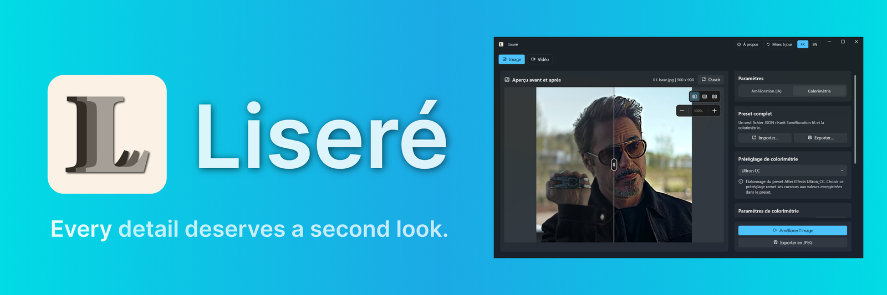

# 🖼️ Liseré

**Améliorez vos photos et vos vidéos, sans les envoyer ailleurs.**

Un espace Image, un espace Vidéo, une comparaison avant/après honnête,
des moteurs qui tournent en local et des exports prêts à garder.

[](https://github.com/FGAMER768/Lisere/releases/latest/download/Lisere-Setup.exe)
[](https://github.com/FGAMER768/Lisere/releases/latest)

[Français](README.md) · [English](README.en.md)

</div>

> [!NOTE]
> **Le rendu GPU est livré dans les versions 1.5.x.** Lisere Classic exécute son
> pipeline en **compute D3D12 (ComputeSharp)** sur le GPU dédié, avec un repli CPU
> exact : amélioration, redimensionnement, grain et étalonnage y passent. Pour les moteurs ONNX, DirectML retient l'adaptateur DirectX 12 qui
> possède le plus de **VRAM dédiée**, et la note du moteur nomme le GPU réellement
> utilisé ; `LISERE_DML_ADAPTER` et `LISERE_CLASSIC_GPU` permettent de le forcer.
> La vidéo encode et décode en matériel — NVENC d'abord, Quick Sync ensuite — après
> une sonde qui réalise un vrai encodage et un vrai décodage.
>
> La revalidation complète sur la RTX 4070 de référence reste ouverte.

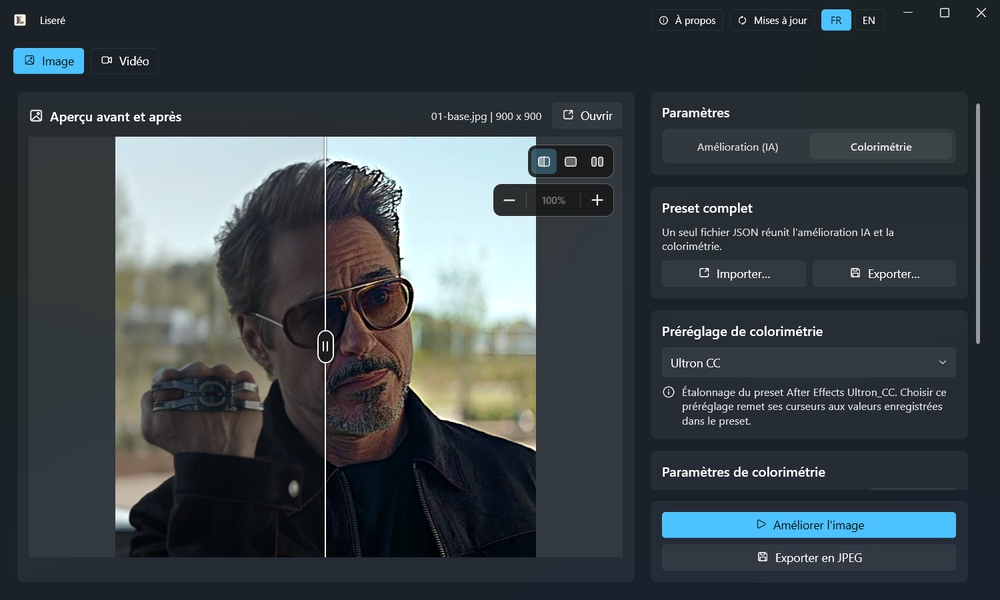

## 📖 Sommaire

- [💡 Pourquoi Liseré ?](#pourquoi)
- [📥 Installation](#installation)
- [⚡ Prise en main](#prise-en-main)
- [✨ Fonctionnalités](#fonctionnalites)
- [🎛️ Préréglages](#prereglages)
- [🖼️ Avant / après](#avant-apres)
- [⌨️ Raccourcis](#raccourcis)
- [📐 Formats et limites](#formats-et-limites)
- [🛠️ Développement](#developpement)
- [❓ FAQ](#faq)
- [❤️ Crédits et licences](#credits-et-licences)

<a id="pourquoi"></a>
## 💡 Pourquoi Liseré ?

- **Tout reste sur votre PC.** Aucun compte, aucun envoi de fichier, aucun service externe.
  Seule la vérification de mise à jour, lancée à votre demande, contacte GitHub.
- **Une comparaison, pas une promesse.** Le séparateur, le mode côte à côte et le zoom
  montrent exactement ce qui a changé, sur la photo comme sur la vidéo.
- **Photos et vidéos dans la même application.** Six réglages fins, des préréglages,
  la colorimétrie, la timeline, l'interpolation RIFE et une file d'attente d'exports.
- **Des presets complets.** Un seul fichier JSON réunit les curseurs, la colorimétrie,
  le moteur utilisé et le renforcement des visages.

<a id="installation"></a>
## 📥 Installation

Téléchargez [Lisere-Setup.exe](https://github.com/FGAMER768/Lisere/releases/latest/download/Lisere-Setup.exe)
puis lancez-le. L'installateur installe Liseré pour le compte Windows courant, sans
droits administrateur et sans rien demander d'autre : le paquet contient l'application
autonome, FFmpeg et les modèles.

L'installation va par défaut dans `%LOCALAPPDATA%\Programs\Lisere`. Un raccourci du
menu Démarrer est proposé, celui du Bureau est optionnel. Pour désinstaller, passez par
**Paramètres → Applications → Liseré** ou `Lisere.exe --uninstall` : vos images,
presets et réglages de `%APPDATA%\Lisere` sont conservés.

> [!NOTE]
> Le code n'est pas signé avec un certificat commercial : Windows peut afficher un
> avertissement SmartScreen au premier lancement. L'empreinte SHA-256 publiée avec la
> release permet de vérifier le fichier. Les scripts de publication acceptent un
> certificat Authenticode (`-CertificateThumbprint` ou `-CertificatePath`).

<details>
<summary>Installation silencieuse ou dossier personnalisé</summary>

```powershell
.\Lisere-Setup.exe --silent --install-dir="D:\Apps\Lisere" --no-shortcuts
```

`--silent` installe sans interface, `--install-dir=...` choisit le dossier,
`--no-shortcuts` n'ajoute aucun raccourci et `--desktop-shortcut` ajoute le raccourci
Bureau. Le code de sortie vaut `0` en cas de succès, `1` sinon. Le dossier choisi doit
être vide ou contenir une installation Liseré existante, car la désinstallation
supprime le dossier d'installation en entier.

</details>

<a id="prise-en-main"></a>
## ⚡ Prise en main

### 🖼️ Une image

1. **Ouvrir** (`Ctrl+O`) : l'original s'affiche, rien n'est calculé.
2. Choisissez un préréglage ou réglez les curseurs. **Colorimétrie** ouvre le second menu.
3. **Améliorer l'image** (`Ctrl+Entrée`).
4. Faites glisser le séparateur, puis **Exporter en JPEG** (`Ctrl+S`).

### 🎬 Une vidéo

1. Onglet **Vidéo**, puis **Ouvrir** (`Ctrl+O`).
2. Choisissez le moteur, le préréglage, la résolution, la cadence et les passes utiles.
3. **Rafraîchir l'aperçu** (`Ctrl+Entrée`) pour comparer la frame courante.
4. **Exporter la vidéo** (`Ctrl+S`), ou **Ajouter à la file** pour enchaîner plusieurs clips.

La lecture suit le temps réel : quand le moteur ne peut pas suivre, les frames sont
sautées au lieu de ralentir le clip, et l'avant comme l'après restent sur la même image.

<a id="fonctionnalites"></a>
## ✨ Fonctionnalités

### 📷 Image

- Ouverture des formats pris en charge par Windows Imaging Component, avec
  normalisation des images CMJN, 16 bits, indexées, progressives ou transparentes.
- Trois modes de comparaison : **Split**, **Single** et **Côte à côte**, avec zoom
  synchronisé et déplacement de l'image agrandie.
- Six réglages d'amélioration : correction de compression, réduction du bruit,
  netteté, récupération des détails, réduction du halo et lissage des contours.
- Détails d'origine, ajout de bruit et **renforcement des visages** (YuNet) : la
  micro-texture se concentre sur la peau, sans grain ajouté au fond ni aux cheveux.
- Préréglages **Chroma**, **Auto**, **Manuel**, **Auto + relatif moyen** et **Aucune**.
- Cinq étalonnages After Effects reproduits : **Ultron CC**, **Matrix CC**,
  **Infinity CC**, **Nebulus CC** et **Splendida CC**, plus un mode manuel.
- Preset complet importable et exportable (curseurs, colorimétrie, moteur, visages).
- Moteur neuronal **Anime ×4** dédié au dessin, à l'animation et à l'art digital,
  en plus du pipeline classique et du moteur général.
- Estimation automatique, avertissements hors plage, estimation de durée avant un
  rendu long, annulation et export JPEG de qualité 92.

### 🎥 Vidéo

- Analyse FFmpeg (`ffprobe`) : résolution, cadence, durée, codecs et audio.
- Timeline de montage, transport clavier, aperçu en direct et comparaison
  avant/après sur la frame choisie.
- **Lecture temps réel** avec saut des frames que le moteur ne peut pas suivre.
- Moteurs interchangeables : **Lisere Classic** (pipeline local déterministe, calcul
  D3D12 sur le GPU dédié ou CPU) ou modèles ONNX vérifiés par SHA-256, dont
  **Anime vidéo ×4** pour l'animation, exécutés sur DirectML avec repli CPU.
- **Encodage et décodage matériel** quand la sonde en trouve un : NVENC d'abord,
  Quick Sync ensuite, sans bascule silencieuse vers le CPU.
- Résolution source, 2×, 4×, 1080p ou 2160p ; cadence source, 30, 60 ou 120 i/s.
- **Interpolation neuronale RIFE ×2**, désentrelacement `bwdif` et stabilisation
  `vidstab` en deux passes.
- Colorimétrie identique à la page Image, figée dans chaque job de la file.
- Import de presets vidéo JSON : six paramètres, détails, bruit, taille, cadence,
  stabilisation et désentrelacement. Aucun poids propriétaire n'est chargé.
- Export MP4 H.264/H.265 avec audio AAC, progression réelle, annulation, aperçu
  rendu d'une seconde et export de ce segment.
- File d'attente séquentielle : chaque job fige ses réglages, un échec n'arrête pas
  les suivants.

### 🧩 Les deux espaces

- Interface française et anglaise, bascule immédiate et mémorisée.
- Traitement asynchrone, dialogues d'attente, erreurs localisées sans détail brut.
- Mise à jour depuis GitHub : contrôle SHA-256, extraction sécurisée, redémarrage.

<a id="prereglages"></a>
## 🎛️ Préréglages

### ⚙️ Amélioration

| Préréglage | Comportement |
|---|---|
| **Chroma** | Préréglage de référence : détail multi-échelles borné, unsharp maîtrisé et courbe de tons relevée sur la référence Topaz. La courbe ne s'applique qu'à la page Image : le modèle Topaz vidéo est neutre en tons. |
| **Auto** | Estime les paramètres à partir de l'image ou de plusieurs frames du clip. |
| **Manuel** | Applique directement les valeurs saisies. |
| **Auto + relatif moyen** | Estimation automatique, puis ajustement relatif moyen. |
| **Aucune** | Aucune correction : seuls la colorimétrie et l'export s'appliquent. |

Quand un moteur anime est sélectionné, **Chroma** cède automatiquement la place à
**Auto** ; un preset Manuel ou Auto déjà choisi n'est pas modifié.

### 🎨 Colorimétrie

| Préréglage | Comportement |
|---|---|
| **Ultron CC** | Saturation 129,997 %, luminosité +5, contraste +7, vibrance +50 et accentuations ; les quatre curseurs restent réglables. |
| **Matrix CC** | Luminosité +30, contraste +20 et trois accentuations fixes. |
| **Infinity CC** | Accentuation multi-échelles, unsharp 16 % / rayon 9,8, halo doux et exposition −0,36. |
| **Nebulus CC** | Accentuation multi-échelles, unsharp 10 % / rayon 20 et halo marqué. |
| **Splendida CC** | Netteté, unsharp 15 % / rayon 25, vignettage 25 % à 40°, luminosité +21 / contraste +10 et courbe maître. |
| **Manuel** | Règle saturation, luminosité, contraste et vibrance à la main. |
| **Aucune** | Aucun étalonnage : l'image garde les couleurs de l'amélioration. |

### 📦 Preset complet

La carte **Preset complet** de la page Image réunit dans un seul JSON les curseurs,
la colorimétrie, le moteur et le renforcement des visages :

```json
{
  "format": "lisere-preset",
  "version": 1,
  "name": "Portrait",
  "enhancement": {
    "mode": "Manual",
    "parameters": {
      "fixCompression": 60,
      "reduceNoise": 40,
      "sharpen": 10,
      "recoverDetails": 85,
      "dehalo": 10,
      "antialiasDeblur": 95
    },
    "recoverOriginalDetail": 20,
    "addNoise": 0,
    "engine": "realesrgan-x4",
    "refineFaces": true
  },
  "color": {
    "preset": "UltronCc",
    "settings": {
      "saturationPercent": 129.997,
      "brightness": 5,
      "contrast": 7,
      "vibrance": 50
    }
  }
}
```

L'import est normalisé : les valeurs hors bornes reviennent dans les plages des
curseurs, et un mode dynamique (`Auto`, `AutoRelativeMedium`) devient **Manuel** avec
les valeurs enregistrées. **Chroma** est conservé si les six valeurs correspondent.
Le moteur enregistré est restauré s'il est installé et disponible ; sinon le moteur
courant est conservé, et les presets antérieurs qui n'en mentionnent pas restent
lisibles. Le renforcement des visages est restauré, puis désactivé si le moteur choisi
est un modèle de super-résolution. Les champs inconnus sont ignorés ; un format ou une
version non reconnus sont refusés avec un message localisé. Si un résultat existe
déjà, l'import le marque comme obsolète jusqu'au prochain rendu.

### 🎞️ Presets vidéo importés

Le bouton **Importer un preset...** lit un JSON exporté par une application
d'amélioration vidéo et transpose ce que Liseré sait reproduire : les six curseurs,
les détails d'origine, le bruit, la taille FHD/4K, la cadence, la stabilisation et le
désentrelacement. Le grain est approximé par un seul dosage de bruit. Le modèle
mentionné est affiché à titre informatif : **aucun poids propriétaire n'est chargé**,
le rendu utilise le moteur sélectionné dans Liseré.

<a id="avant-apres"></a>
## 🖼️ Avant / après

Le préréglage **Chroma** et sa courbe de tons ont été réglés puis comparés à un rendu
de référence produit avec Topaz. Les trois images partagent le même cadrage et la même
résolution (1608 × 1608) :

| Base (image de départ) | Topaz (référence) | Liseré (rendu local) |
|---|---|---|
|  |  |  |

**Base** est l'image de départ. **Topaz** est le rendu de référence obtenu avec le
preset Ultron CC. **Liseré** est le rendu local, avec le préréglage Chroma et
l'étalonnage Ultron CC. La comparaison porte sur la netteté, la micro-texture de la
peau et des cheveux, le rendu du cuir et les tons moyens. Les trois images du tableau
sont des JPEG réduits à 900 px ; les fichiers de travail ne sont pas distribués.

### 🎬 Liseré, After Effects et Topaz sur des plans 4K

Dix photogrammes 4K du même extrait ont été passés dans trois chaînes : **Liseré**
(moteur Liseré Classic, préréglage Chroma, étalonnage Ultron CC), **After Effects CC**
seul (étalonnage Ultron CC, sans amélioration) et **Topaz puis After Effects CC**
(amélioration Chroma et Ultron CC). Deux plans sont montrés ici ; chaque plan occupe
deux lignes, l'image entière réduite à 960 × 960 puis un détail à 100 % (210 × 210
pixels natifs).

| Source 4K | Liseré Classic + Ultron CC | After Effects CC | Topaz + AE CC |
|---|---|---|---|
|  |  | 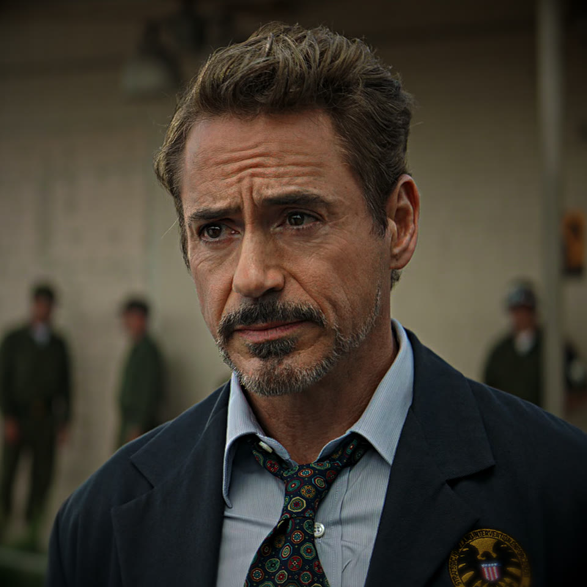 |  |
|  | 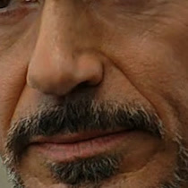 |  |  |
| 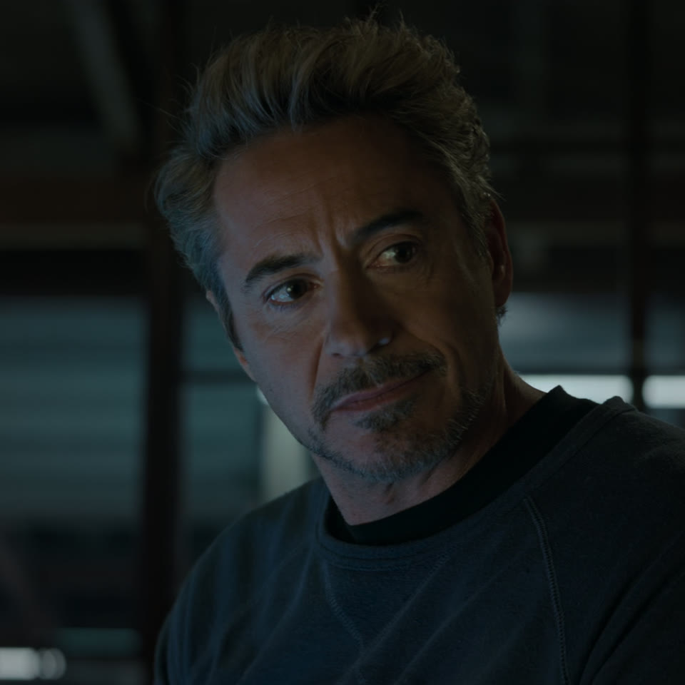 | 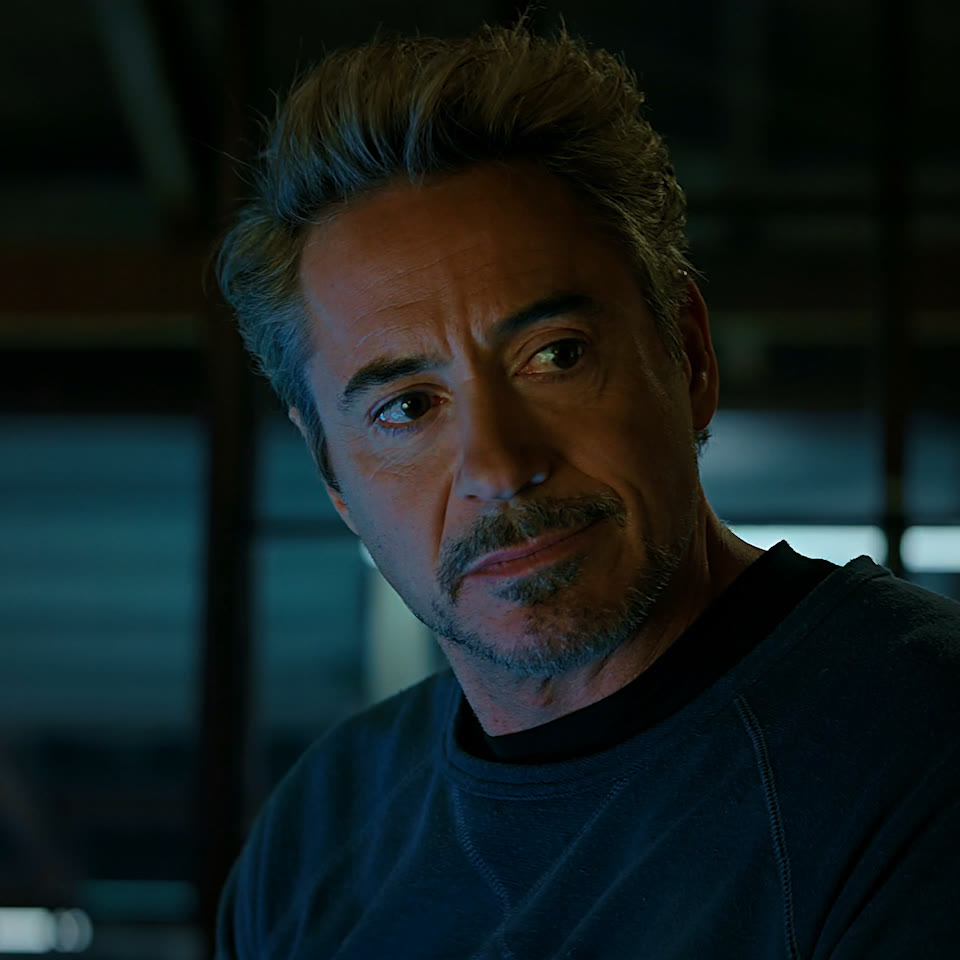 |  | 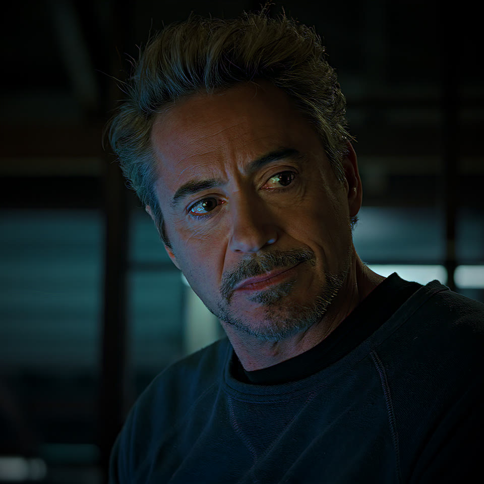 |
| 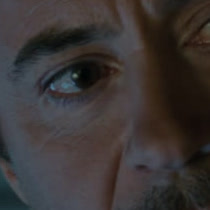 | 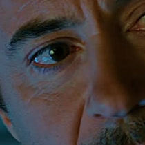 |  | 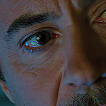 |

L'étalonnage Ultron CC est le même dans les trois colonnes ; seule l'amélioration
diffère. Liseré tient la micro-texture de la barbe, des mèches et des rides avec des
contours plus souples ; Topaz + AE CC va plus loin en netteté, au prix d'une peau plus
sèche et de contours plus durs. After Effects CC seul ne change que la colorimétrie.

### 🧪 Deux démonstrations + un bonus upscale

Deux cas générés par le pipeline de la page Image, avec les réglages exacts, et un
bonus d'upscale ×4. Chaque comparatif se lit de gauche à droite : avant, puis après ;
la seconde rangée est un détail à 100 %.

**1. Photo 1608 px : Auto + Ultron CC**


Source 1608 × 1608. Préréglage **Auto**, étalonnage **Ultron CC**, aucun renforcement
de visages, aucun agrandissement. Sortie 1608 × 1608.

**2. Portrait 1916 × 2608 : Auto sans étalonnage**

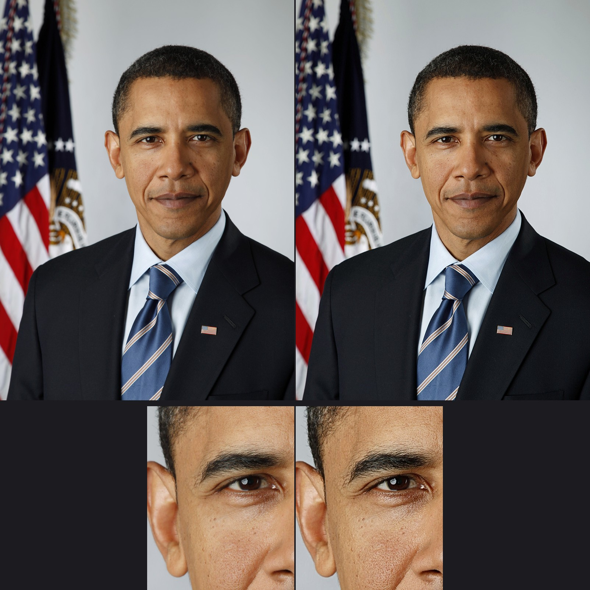

Source 1916 × 2608. Préréglage **Auto**, **aucune colorimétrie**, aucun renforcement
de visages, aucun agrandissement. Sortie 1916 × 2608.

**Bonus : paysage 640 × 427, upscale ×4**

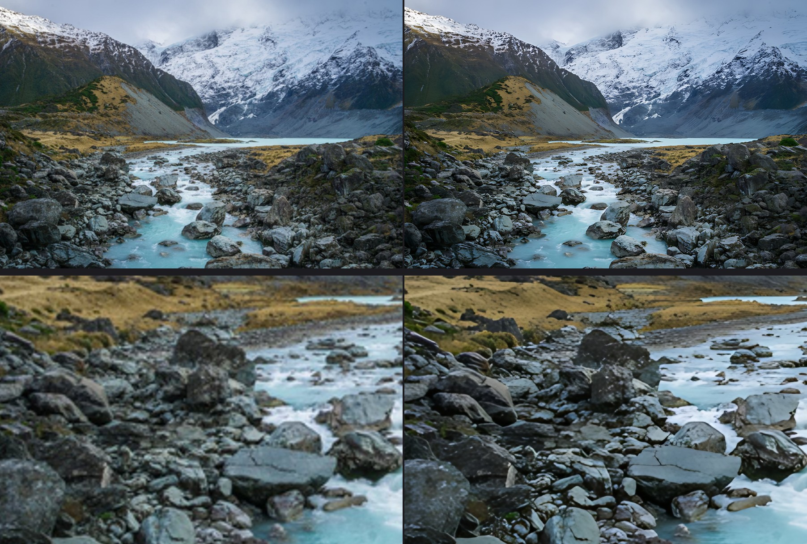

Source 640 × 427. Comparatif **bicubique ×4** / **Real-ESRGAN ×4**, détails d'origine
20, sortie 2560 × 1708. Ce rendu utilise le **moteur ×4 de l'export vidéo** ; la page
Image conserve la taille source.

*Crédits images.* Démo 1 et comparatifs ci-dessus : photogramme de la saga *Iron Man*
(Marvel Studios), utilisé à titre illustratif ; tous droits réservés. Démo 2 :
portrait officiel de Barack Obama par **Pete Souza**, licence
[CC BY 3.0](https://creativecommons.org/licenses/by/3.0/), via
[Wikimedia Commons](https://commons.wikimedia.org/wiki/File:Official_portrait_of_Barack_Obama.jpg).
Bonus : photo de Danny Postma, CC0, via
[AltPhotos](https://altphotos.com/photo/hooker-lake-at-the-bottom-of-mount-cook-new-zealand-1747/).

### 🎞️ Anime 6B ou AnimeVideo v3 ?

Le même extrait de **Namakura Gatana** (1917), 320 × 180 à 12 i/s sur 5 s, passé en
×4 avec les deux moteurs anime. Les réglages sont identiques : préréglage **Manuel**
à zéro, aucune colorimétrie, sortie 1280 × 720, 60 images. À gauche **AnimeVideo v3**,
à droite **Anime 6B**.

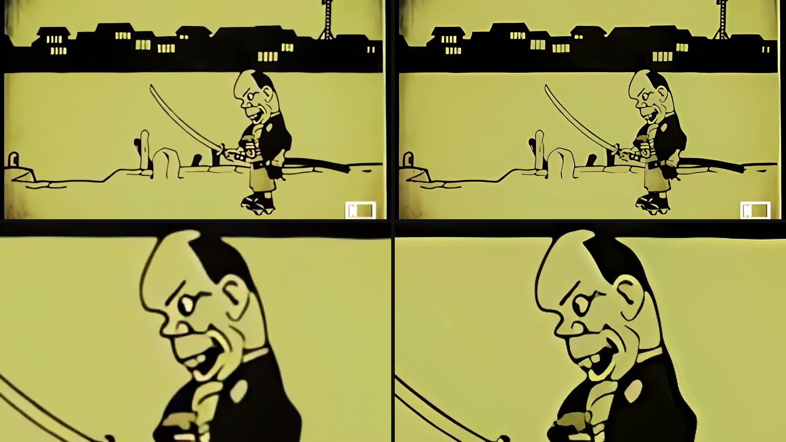

En haut, l'image entière ; en bas, un détail à 100 %. **AnimeVideo v3** garde davantage
de grain et de micro-texture ; **Anime 6B** lisse plus franchement les aplats et les
traits, au prix d'un rendu plus doux.

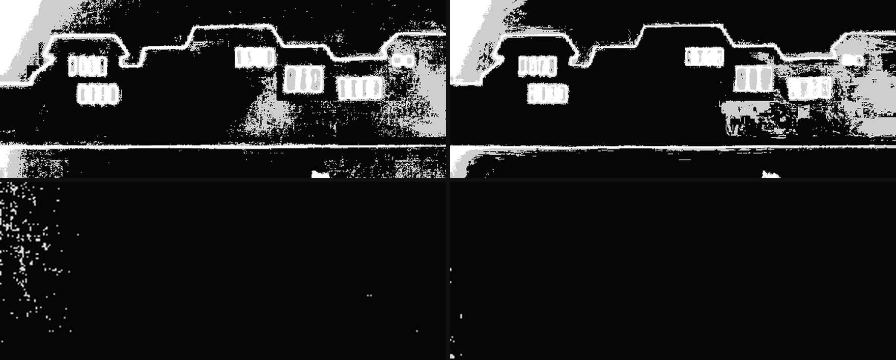

La seconde planche mesure la **différence moyenne entre images consécutives**,
amplifiée ×200 : en haut les toits et le ciel, en bas un aplat de sol. Plus la carte est
sombre, moins la zone change d'une image à l'autre.

| Mesure (0–255) | Bicubique | AnimeVideo v3 | Anime 6B |
|---|---:|---:|---:|
| Delta global moyen | 1,501 | **1,617** | 1,741 |
| Delta zone plate, moyenne | 0,068 | 0,177 | **0,093** |
| Écart-type temporel par pixel, zone plate | 0,791 | 0,895 | **0,742** |
| Écart-type temporel par pixel, texture p95 | 12,59 | **21,27** | 28,01 |

**AnimeVideo v3 n'est donc pas universellement plus stable.** Il est plus stable
globalement et sur les textures très détaillées, mais Anime 6B bouge moins sur les
aplats. Le rendu 6B est aussi beaucoup plus lent : **72,3 s** contre **9,9 s** pour ces
60 images sur DirectML. Les deux modèles traitent chaque image indépendamment ; aucun
n'ajoute de cohérence temporelle explicite.

Le même export complet lancé depuis la fenêtre Liseré (AnimeVideo v3, 4×, Manuel à
zéro) donne exactement **1280 × 720, 60 images, 5,00 s**. Comparé au rendu du harness :
**PSNR 40,67 dB**, **SSIM 0,991**, l'écart restant venant de la qualité d'encodage
(651 296 octets contre 1 354 678).

*Crédit.* Extrait de **Namakura Gatana** (『なまくら刀』, 1917) de **Jun'ichi Kōuchi**,
film japonais du domaine public, via
[Internet Archive](https://archive.org/details/1917-the-dull-sword-namakura-gatana).

<a id="raccourcis"></a>
## ⌨️ Raccourcis

| Raccourci | Image | Vidéo |
|---|---|---|
| `Ctrl+O` | Ouvrir une image | Ouvrir une vidéo |
| `Ctrl+Entrée` | Lancer l'amélioration | Rafraîchir l'aperçu |
| `Ctrl+S` | Exporter en JPEG | Exporter la vidéo |
| `Espace` | - | Lecture / pause |
| `Ctrl+←` / `Ctrl+→` | - | Image précédente / suivante |

Les boutons **FR** et **EN** de la barre de titre changent la langue sans redémarrage ;
le choix est enregistré dans `%APPDATA%\Lisere\settings.json`.

<a id="formats-et-limites"></a>
## 📐 Formats et limites

<details>
<summary>🔍 Images, vidéos et comportement des moteurs</summary>

### 📷 Image

- Entrées proposées : `.png`, `.jpg`, `.jpeg`, `.bmp`, `.tif`, `.tiff`, `.gif`, `.ico`,
  `.wdp`, `.jxr`, `.webp`, `.heic`, `.heif` et `.avif`, selon les codecs Windows.
- L'orientation EXIF est appliquée ; la transparence est composée sur fond blanc.
  Les images animées ou multipages n'utilisent que leur première image.
- Taille maximale du fichier : 24 Mo. Limite de décodage : 40 millions de pixels.
- Export JPEG uniquement, qualité 92.

### 🎥 Vidéo

- Entrées proposées : `.mp4`, `.mov`, `.mkv`, `.avi`, `.webm`, `.m4v`, `.mts`,
  `.m2ts`, `.wmv`, `.mpg`, `.mpeg`, selon les codecs FFmpeg.
- Sortie MP4 H.264 ou H.265 avec audio AAC. La rotation portée par les métadonnées
  vidéo n'est pas appliquée au décodage.
- RIFE est limité au **×2**. Sur l'Intel Iris Xe de référence, une inférence 1080p
  coûte environ 0,83 s après chauffe (0,037 s en 192×192) ; le repli CPU est bien
  plus lent.
- **BasicVSR++ n'est pas intégré** : les poids officiels sont PyTorch et l'alignement
  DCN dépend de CUDA. Aucun ONNX vérifiable n'est distribué.
- **La restauration de visages n'est pas intégrée** : GFPGAN et CodeFormer exigent un
  détecteur, un alignement 512×512 et un collage, pour des poids de 340 à 377 Mo.
- L'aperçu d'une seconde écrit un MP4 temporaire dans `%TEMP%\Lisere\previews`, purgé
  après 24 h ; l'export de l'aperçu va vers le fichier choisi. Ni l'un ni l'autre ne
  conserve l'audio.

### 🧠 Moteurs et presets

- Les moteurs ONNX tournent sur **DirectML** quand un adaptateur DirectX 12 est
  disponible, avec un repli CPU dont la raison est affichée dans la note du moteur.
- **Lisere Classic** choisit l'adaptateur D3D12 avec le plus de VRAM dédiée et affiche
  le GPU utilisé ; `LISERE_CLASSIC_GPU` force un index ou un fragment de nom, et
  `0`/`cpu`/`off` le replace sur le CPU. L'amélioration et le redimensionnement sont
  calculés sur GPU, puis l'étalonnage est appliqué sur CPU.
- L'import de presets ne charge aucun poids propriétaire et ne reproduit pas les
  modèles d'origine : seuls les réglages, la taille et la cadence sont transposés.
- `outSizeMethod` 6 → 1080p et 7 → 2160p sont déduits du corpus de presets ; les
  autres méthodes retombent sur la géométrie source. Le grain est approximé par un
  seul dosage de bruit.
- Le mode Auto échantillonne trois positions du clip ; il ne remplace pas un
  estimateur neuronal dédié.
- **L'estimation de durée est indicative** : elle s'appuie sur un coût appris par
  moteur, alors que le temps restant pendant le rendu suit la progression réelle.

</details>

<a id="developpement"></a>
## 🛠️ Développement

### 📋 Prérequis

- Windows 10 ou Windows 11.
- [SDK .NET 10](https://dotnet.microsoft.com/download) pour compiler ; l'installateur
  n'en a pas besoin, l'application est autonome.
- FFmpeg est fourni dans les publications. Sur un checkout neuf, lancez
  `scripts/fetch-ffmpeg.ps1` pour les tests vidéo.

```powershell
dotnet restore Lisere.slnx
dotnet run --project src/Lisere
dotnet build Lisere.slnx
dotnet test Lisere.slnx
```

Dans Visual Studio, ouvrez `Lisere.slnx`, choisissez `src/Lisere` comme projet de
démarrage et lancez avec `F5`. En développement, `LISERE_FFMPEG` reste prioritaire sur
le paquet intégré. `src/Lisere.Setup` est volontairement hors de la solution : il cible
`net48` et doit être construit avec `scripts/build-setup.ps1`.

<details>
<summary>🏗️ Architecture et structure du dépôt</summary>

| Projet | Rôle |
|---|---|
| `src/Lisere` | Application WPF, pages Image et Vidéo, view models, services de dialogue, fichiers, localisation, mise à jour et désinstallation. |
| `src/Lisere.Setup` | Installateur WPF : extraction du paquet embarqué, copie par utilisateur, raccourcis et désinstallation. |
| `src/Lisere.Core` | Modèles d'image, filtres, estimation, validation, pipeline d'amélioration, détection de visages et traitement de clip. |
| `src/Lisere.Ai` | Moteurs (`IFrameEnhancer`, `IFrameInterpolator`), pipeline classique CPU/D3D12, super-résolution ONNX tuilée, RIFE, YuNet, DirectML/CPU et catalogue vérifié. |
| `src/Lisere.Video` | FFmpeg, `ffprobe`, extraction de frames, rendu, désentrelacement, stabilisation, interpolation, presets et progression. |
| `tests/` | Quatre projets xUnit : Core, Ai, Video et App. |

La page Image s'organise autour de `EnhanceViewModel` et `IEnhancementOrchestrator`.
La page Vidéo utilise `VideoViewModel`, découpé par fonction (file, aperçu, rendu) ;
elle délègue l'analyse à `IVideoProbe`, les vignettes à `VideoPreviewRenderer`, le plan
de confirmation à `VideoRenderPlanFactory` et le rendu à `IVideoRenderService`. Le
choix du moteur passe par `IFrameEnhancer` : l'interface et la vidéo ignorent quel
modèle tourne. `models/catalog.json` décrit chaque modèle (fichier, échelle, licence,
empreinte) ; un modèle absent ou modifié est signalé indisponible.

```text
Lisere.slnx
assets/            icône, captures, comparaisons
src/               Lisere, Lisere.Core, Lisere.Ai, Lisere.Video, Lisere.Setup
tests/             Core, Ai, Video, App
models/            catalog.json, onnx/, rife/, yunet/
ffmpeg/            manifeste, DLL, licences
Update/            version.txt et documentation des mises à jour
scripts/           ffmpeg, publication, installateur, signature
```

</details>

<details>
<summary>🧪 Tests et publication</summary>

La suite compte **564 tests** (140 Core, 46 Ai, 98 Video, 280 App) avec 0 avertissement
de build. Les tests vidéo d'intégration génèrent un clip avec FFmpeg et vérifient le
rendu, l'audio, le désentrelacement, la taille, l'annulation et l'extraction d'aperçu ;
ils sont ignorés si FFmpeg est introuvable. Les presets sont couverts sur des JSON
synthétiques et, si `LISERE_PRESET_SAMPLE_DIR` est défini, sur un corpus local. RIFE
est testé en inférence réelle, en rendu simulé puis en rendu réel (10 → 20 i/s).

Pour publier une version :

1. Modifiez `<Version>` dans `src/Lisere/Lisere.csproj`.
2. Lancez `powershell -ExecutionPolicy Bypass -File scripts/publish-update.ps1`.
   Le script produit `Update/Lisere.zip`, son `.sha256` et `Update/version.txt`.
3. Reconstruisez l'installateur avec `scripts/build-setup.ps1` : il embarque ce ZIP et
   produit `artifacts/installer/Lisere-Setup.exe`, sa copie versionnée et son empreinte.
4. Créez une release GitHub `v<version>` avec les quatre assets : `Lisere-Setup.exe`,
   `Lisere-Setup.exe.sha256`, `Lisere.zip` et `Lisere.zip.sha256`. Elle doit rester la
   release la plus récente, car l'application utilise `releases/latest`.
5. Committez et poussez `Update/version.txt` **après** le téléversement des assets.
6. Vérifiez depuis une installation précédente : **Mises à jour → Vérifier → Installer**,
   puis le redémarrage.

Les deux scripts acceptent `-CertificateThumbprint` ou `-CertificatePath` pour signer
les artefacts. `Update/*.zip`, `Update/*.sha256` et `artifacts/` sont ignorés par Git.
Le détail du paquet et des garde-fous d'extraction est dans
[`Update/README.md`](Update/README.md).

</details>

<a id="faq"></a>
## ❓ FAQ

**Mes fichiers quittent-ils ma machine ?**
Non. Tout le traitement est local. Seule la vérification de mise à jour, quand vous la
demandez, interroge GitHub.

**Faut-il un GPU ?**
Pas pour lancer l'application. **Lisere Classic** exécute son pipeline en compute D3D12
sur le GPU dédié quand il est disponible, avec un repli CPU exact. `LISERE_CLASSIC_GPU`
force un index ou un fragment de nom d'adaptateur ; `0`, `cpu` ou `off` désactive le GPU.
Les moteurs ONNX utilisent DirectML sur
l'adaptateur DXGI qui possède le plus de **VRAM dédiée** (l'iGPU est écarté quand une
carte dédiée est présente), avec un repli CPU dont la raison est affichée dans la note
du moteur. La variable `LISERE_DML_ADAPTER` force un index DXGI ou un fragment de nom
d'adaptateur. Le repli CPU est nettement plus lent. La revalidation complète sur la
RTX 4070 de référence reste ouverte.

**Pourquoi Windows affiche-t-il un avertissement au lancement ?**
Le binaire n'est pas signé avec un certificat commercial. Vérifiez l'empreinte SHA-256
publiée avec la release, ou signez vos propres builds avec les scripts fournis.

**Puis-je importer mes presets d'une autre application ?**
Oui pour les presets vidéo JSON : Liseré transpose les réglages qu'il comprend. Aucun
poids propriétaire n'est lu, et le rendu utilise le moteur choisi dans Liseré.

**Où sont mes réglages ?**
Dans `%APPDATA%\Lisere`. La désinstallation de l'application les conserve.

**Pourquoi un rendu vidéo est-il long ?**
Chaque image traverse le moteur, et RIFE, la stabilisation ou le désentrelacement
ajoutent des passes. L'estimation avant rendu donne un ordre de grandeur ; le temps
restant affiché suit la progression réelle.

**Comment désinstaller ?**
**Paramètres → Applications → Liseré**, ou `Lisere.exe --uninstall`. Les images,
presets et réglages restent dans `%APPDATA%\Lisere`.

<a id="credits-et-licences"></a>
## ❤️ Crédits et licences

Liseré est conçu et développé par **FGAMER768**. Il ne redistribue aucun poids, code
ou média propriétaire.

### 🧠 Modèles

- **YuNet** (détection de visages) : Shiqi Yu / OpenCV Zoo, licence MIT.
- **RIFE 4.9** (interpolation) : Practical-RIFE, licence MIT.
- **SRCNN sous-pixel ×3** : ONNX Model Zoo, licence Apache-2.0.
- **Nettoyage 1× RealPLKSR** : Philip Hofmann, licence CC-BY-4.0.
- **Real-ESRGAN général ×4** : xinntao/Real-ESRGAN, export ONNX, licence BSD-3-Clause.
- **Real-ESRGAN Anime 6B ×4** : xinntao/Real-ESRGAN, export ONNX SkillSafe,
  licence BSD-3-Clause.
- **Real-ESRGAN AnimeVideo v3 ×4** : xinntao/Real-ESRGAN, export ONNX SkillSafe,
  licence BSD-3-Clause.
- **ONNX Runtime et DirectML** : Microsoft, licence MIT.
- **FFmpeg** : compilation BtbN sous GNU GPL v3 ; provenance, empreintes et licence
  dans `ffmpeg/README.md` et `ffmpeg/LICENSE.txt`.

Les licences complètes et les empreintes sont dans [`models/README.md`](models/README.md).

### 📚 Bibliothèques

**WPF-UI**, **Fluent System Icons**, **CommunityToolkit.Mvvm**,
**Microsoft.Extensions.Hosting**, **xUnit.net** et **Microsoft.NET.Test.Sdk**, sous
licences MIT ou Apache-2.0 selon le projet.

### 🪪 Identité et références

- L'icône (`assets/LisereIcon.svg`, `assets/Lisere.ico`, `assets/LisereIcon.png`) a été
  créée pour le projet.
- Les presets **Ultron CC**, **Matrix CC**, **Infinity CC**, **Nebulus CC** et
  **Splendida CC** font référence à des presets After Effects analysés ; Adobe After
  Effects et ces noms appartiennent à leurs détenteurs. Aucun fichier `.ffx` n'est
  distribué.
- La courbe de tons de **Chroma** a été relevée sur un rendu Topaz ; Topaz est une
  marque de Topaz Labs. Aucun poids, code ou média Topaz n'est distribué.

### 🧪 Images de test et documentation

- `tests/Lisere.App.Tests/TestData/face.jpg` : portrait officiel de Barack Obama par
  Pete Souza (CC BY 3.0), recadré pour les tests ; voir le README du dossier.
- `tests/Lisere.App.Tests/TestData/preset-photo.jpg` : photo de Jeff Sheldon
  (Lorem Picsum / Unsplash), pour la non-régression colorimétrique.
- [GUIDE-UTILISATION.md](GUIDE-UTILISATION.md) : guide complet en français.
- [GUIDE-UTILISATION.en.md](GUIDE-UTILISATION.en.md) : complete English user guide.
- [docs/MODELES-CANDIDATS.md](docs/MODELES-CANDIDATS.md) : modèles libres comparables.
