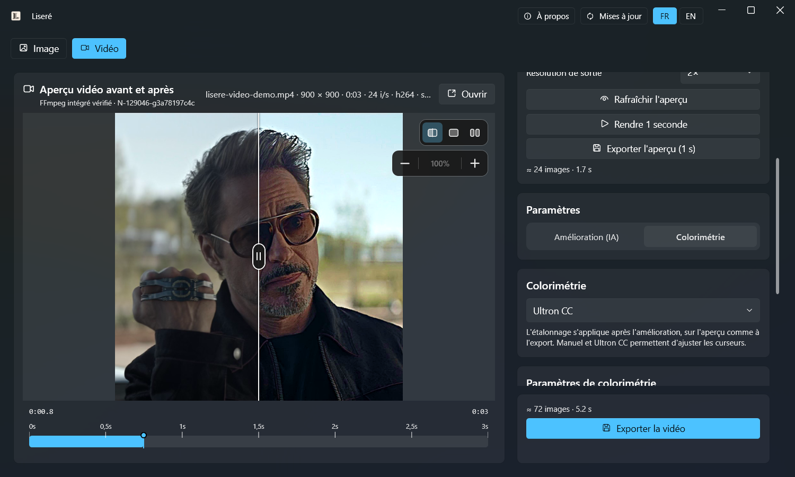

# Liseré


[Français](README.md) | [English](README.en.md)

Liseré est une application de bureau Windows pour améliorer **une image ou une vidéo**, comparer le résultat à l'original et exporter la version retouchée. Les traitements sont effectués localement : aucun service externe, aucun compte. Seule la vérification de mise à jour, lancée à votre demande, contacte GitHub.

## Aperçu

| Espace Image | Espace Vidéo |
|:---:|:---:|
|  |  |

Captures de l'application avec l'amélioration **Chroma** et l'étalonnage **Ultron CC**, la comparaison avant/après, les trois modes de prévisualisation et la timeline vidéo.

## Installation

La version installable se trouve dans la dernière [release GitHub](https://github.com/FGAMER768/Lisere/releases/latest). Téléchargez [Lisere-Setup.exe](https://github.com/FGAMER768/Lisere/releases/latest/download/Lisere-Setup.exe) et lancez-le : l'installateur installe Liseré pour le compte Windows courant, sans droits administrateur et sans demander d'installer l'application ou ses dépendances. Le paquet contient l'application autonome et FFmpeg.

Par défaut, Liseré est installé dans `%LOCALAPPDATA%\Programs\Lisere`. L'installateur propose un raccourci dans le menu Démarrer et, en option, sur le Bureau. Pour désinstaller, utilisez **Paramètres → Applications → Liseré** ou `Lisere.exe --uninstall` ; les images, presets et réglages de `%APPDATA%\Lisere` sont conservés.

Le dossier choisi doit être vide ou contenir une installation Liseré existante : l'installateur refuse d'écraser un dossier non vide, car la désinstallation supprime le dossier d'installation en entier. Le paquet est autonome et n'a besoin d'aucun accès réseau pour s'installer.

Pour un déploiement silencieux, par exemple dans un script ou sur une image de poste de travail :

```powershell
.\Lisere-Setup.exe --silent --install-dir="D:\Apps\Lisere" --no-shortcuts
```

`--silent` installe sans interface, `--install-dir=...` choisit le dossier, `--no-shortcuts` n'ajoute aucun raccourci et `--desktop-shortcut` ajoute le raccourci Bureau. Le code de sortie vaut `0` en cas de succès, `1` sinon. L'installateur reconnaît aussi une installation existante grâce à `Lisere.exe` ou au marqueur `.lisere`, ce qui permet de la mettre à jour sur place.

> La signature Authenticode est prise en charge par les scripts de publication. Une release signée avec le certificat de FGAMER768 est produite avec `-CertificateThumbprint` ou `-CertificatePath` ; sans certificat, Windows peut afficher un avertissement SmartScreen. L'empreinte SHA-256 publiée avec la release permet de vérifier le fichier.

L'interface propose deux espaces :

- **Image** : pipeline déterministe six paramètres, préréglages, estimation automatique, menu de colorimétrie séparé, export JPEG.
- **Vidéo** : analyse FFmpeg, aperçu avant/après, timeline de montage, rendu image par image, moteurs interchangeables (pipeline local ou modèles ONNX), résolutions FHD/4K, cadence 30/60/120 i/s, interpolation neuronale RIFE ×2, désentrelacement, stabilisation, colorimétrie, file d'attente et export MP4 avec audio.

FFmpeg est livré avec l'application et vérifié par SHA-256 au démarrage. Un bouton **Mises à jour** dans la barre de titre vérifie les versions publiées sur GitHub, télécharge le paquet, contrôle son empreinte, puis l'installe au redémarrage.

## Fonctionnalités

### Image

- Ouverture des images prises en charge par Windows Imaging Component, avec normalisation des cas irréguliers.
- Comparaison avant/après avec séparateur déplaçable sur toute la hauteur de l'image.
- Trois modes de comparaison : **Split** (séparateur), **Single** (sortie seule) et **Côte à côte**, choisis par des icônes dans le coin supérieur droit. Les mentions Avant/Après sont retirées du pied de l'aperçu.
- L'ouverture affiche l'original : l'amélioration n'est calculée qu'au clic sur **Améliorer l'image**.
- Deux menus de paramètres, **Amélioration (IA)** et **Colorimétrie**, chacun avec son préréglage et ses curseurs.
- Préréglages d'amélioration Chroma, Auto, Manuel et Auto + relatif moyen.
- Préréglages de colorimétrie **Ultron CC**, **Matrix CC**, **Infinity CC**, **Nebulus CC**, **Splendida CC**, reproductions de presets After Effects appliquées après l'amélioration (`docs/ULTRON-CC-ANALYSE.md` et `docs/PRESETS-ANALYSE.md`), et **Manuel (curseurs)** pour régler saturation, luminosité, contraste et vibrance.
- Réglages de correction de compression, réduction du bruit, netteté, récupération des détails, réduction du halo et lissage des contours.
- Réglages complémentaires pour les détails d'origine et l'ajout de bruit.
- **Renforcement des visages** : YuNet (MIT) localise les visages et concentre la micro-texture sur leur peau, sans ajouter de grain au fond ni aux cheveux. Si le modèle est absent, Liseré revient au masque de peau global sans bloquer le rendu.
- **Aperçu obsolète** : après un changement de réglage ou l'import d'un preset, l'aperçu existant reste visible mais porte un bandeau et l'export est désactivé jusqu'au prochain rendu.
- Estimation automatique des paramètres à partir du contenu de l'image.
- Avertissements lorsque les réglages sortent des plages conseillées.
- Export JPEG avec une qualité de 92.
- Confirmation avec estimation de durée avant une amélioration longue (au-delà de ~4 s estimées, mesurées à ~2,4 s par mégapixel).
- Annulation des chargements, traitements et exports depuis la fenêtre d'attente.

### Vidéo

- **FFmpeg intégré** : compilation Windows livrée dans `ffmpeg/`, avec `ffmpeg.exe`, `ffprobe.exe`, les DLL et un manifeste d'empreintes. Le paquet est vérifié au démarrage ; si un fichier manque ou a été modifié, les fonctions vidéo sont désactivées avec une raison explicite.
- Analyse du fichier avec `ffprobe` : résolution, cadence, durée, codec, présence et codec audio.
- Aperçu avant/après sur une image extraite à la position choisie ; l'ouverture ne calcule pas l'aperçu, il faut le demander explicitement (`Ctrl+Entrée`).
- **Timeline de montage** : règle temporelle, graduations, tête de lecture, clic/glisser pour se déplacer, flèches et `Home`/`End` au clavier.
- **Aperçu en direct** : déplacer la tête de lecture recharge la frame source à la nouvelle position ; dès qu'un aperçu existe, l'image après est recalculée au même endroit, au rythme du moteur. Une nouvelle demande annule celle qui n'a pas encore abouti.
- **Transport** : début, image précédente, lecture/pause, image suivante et fin de la vidéo. La lecture avance image par image au rythme du décodage et s'arrête à la fin du clip.
- Application des six mêmes paramètres à chaque image, avec estimation Auto échantillonnée sur le clip.
- **Colorimétrie vidéo** : les mêmes onglets **Amélioration (IA)** et **Colorimétrie** que la page Image, avec les cinq étalonnages (Ultron CC, Matrix CC, Infinity CC, Nebulus CC, Splendida CC) et **Manuel (curseurs)**. Ils s'appliquent à chaque image, après l'amélioration et avant la courbe Chroma. Le choix est figé dans chaque job de la file.
- Moteurs interchangeables :
  - **Lisere Classic** : pipeline local déterministe, toujours disponible ;
  - **Super-Resolution CNN ×3** : modèle ONNX local, vérifié par SHA-256, inférence DirectML sur iGPU avec repli CPU.
- Résolution de sortie : source, 2×, 4×, 1080p ou 2160p ; la largeur FHD/4K est calculée selon le ratio source et arrondie à une valeur paire.
- Cadence de sortie : source, 30, 60 ou 120 i/s (`minterpolate`, uniquement si la cadence diffère).
- **Interpolation neuronale RIFE ×2** : modèle ONNX RIFE 4.9 (MIT), deux images et un timestep, exécuté sur DirectML (iGPU Intel) avec repli CPU. La cadence est doublée ; c'est volontairement limité au ×2.
- Désentrelacement (`bwdif`) avant l'amélioration, pour les sources entrelacées.
- Stabilisation en deux passes (`vidstab`).
- **Import de presets vidéo (JSON)** : lit le JSON d'un preset (six paramètres, récupération des détails, bruit, taille FHD/4K, cadence, stabilisation, désentrelacement) et l'applique à Liseré. Aucun poids propriétaire n'est lu ni utilisé.
- **File d'attente multi-clips** : chaque job fige la source et les réglages, les exports s'exécutent séquentiellement, un échec n'interrompt pas les suivants, l'arrêt annule le job en cours.
- Export MP4 H.264 ou H.265, qualité CRF réglable, piste audio d'origine conservée (AAC 192 kbit/s).
- Progression par étape et annulation réelle des processus FFmpeg.
- **Estimation avant rendu** : nombre d'images et durée approximative recalculés selon le moteur, la résolution, la cadence, RIFE et les passes optionnelles. Elle apparaît dans la colonne de réglages et dans la carte d'export.
- **Confirmation avant rendu** : un dialogue montre la source et le rendu courant, les réglages, la destination et l'estimation ; rien n'est lancé sans validation.
- **Aperçu rendu d'une seconde** : rend le segment réel autour de la position choisie avec les mêmes réglages, puis affiche la frame obtenue.
- **Export de l'aperçu** : le même segment d'une seconde peut être écrit vers un fichier choisi, sans audio, pour l'inspecter ou le conserver.
- **Frame en direct** : pendant un rendu, la dernière image produite remplace l'aperçu et reste visible après une annulation.
- **Zoom synchronisé** : molette, boutons ou touches `+` / `−` / `0` sur la comparaison ; avant et après zooment ensemble, le point sous le curseur reste en place (le centre reste au centre), et un glisser déplace l'image agrandie. Les icônes `−` / `+` sont centrées dans leurs boutons.
- **Trois modes de preview** : split, single (sortie seule) et côte à côte, disponibles avec des icônes sur la comparaison image et vidéo.

### Commun

- Interface française et anglaise, bascule immédiate depuis la barre de titre et mémorisation du choix.
- Traitement asynchrone, dialogues d'attente et messages d'erreur localisés, sans détail technique brut.
- Raccourcis clavier : `Ctrl+O` ouvrir, `Ctrl+Entrée` lancer l'aperçu ou l'amélioration, `Ctrl+S` exporter.
- Annulation accessible pour les opérations image, l'analyse et l'aperçu vidéo, les rendus et la file d'attente.
- Mise à jour depuis GitHub avec progression, contrôle SHA-256, extraction sécurisée et redémarrage automatique.

## Comparaison avec la référence

Le préréglage **Chroma** et sa courbe de tons ont été réglés puis comparés à un rendu de référence produit avec Topaz. Les trois images ci-dessous partagent le même cadrage et la même résolution (1608 × 1608) :

| Base (image de départ) | Topaz (référence) | Liseré (rendu local) |
|---|---|---|
|  |  |  |

**Base** est l'image de départ. **Topaz** est le rendu de référence obtenu avec le preset Ultron CC. **Liseré** est le rendu local, avec le préréglage Chroma et l'étalonnage Ultron CC.

La comparaison porte sur la netteté, la micro-texture de la peau et des cheveux, le rendu du cuir et les tons moyens. Les images affichées sont des versions JPEG réduites à 900 px pour la documentation ; les fichiers de travail ne sont pas inclus dans le paquet distribué.

## Prérequis

- Windows 10 ou Windows 11.
- **Avec l'installateur** : aucun runtime .NET à télécharger. L'application est autonome ; l'installateur utilise uniquement .NET Framework 4.8, fourni avec Windows 10 et Windows 11.
- **Pour compiler depuis les sources** : [.NET SDK 10.0](https://dotnet.microsoft.com/download) ou version ultérieure compatible avec `net10.0-windows`.
- **FFmpeg** est fourni avec les publications dans `ffmpeg/` ; la page Vidéo vérifie ses empreintes au démarrage. Pour un checkout neuf, lancez `scripts/fetch-ffmpeg.ps1`. En développement, `LISERE_FFMPEG` et une installation externe restent prioritaires.
- Aucune base de données et aucun compte ne sont nécessaires. La vérification des mises à jour est la seule action réseau, et elle reste facultative.

Cinq modèles ONNX sont inclus dans `models/` et copiés à côté de l'exécutable : SRCNN ×3 (240 Ko, Apache-2.0), Real-ESRGAN général ×4 (4,6 Mo, BSD-3-Clause), nettoyage RealPLKSR 1× (29,9 Mo, CC-BY-4.0), RIFE 4.9 (20,5 Mo, MIT) et YuNet (227 Ko, MIT). Le choix du moteur est proposé sur les deux pages : sur les photos, Classic reste le défaut et le modèle 1× nettoie l'image sans changer sa taille. Voir [models/README.md](models/README.md) et la section [Crédits, sources et licences](#crédits-sources-et-licences). DirectML est utilisé automatiquement pour les moteurs ONNX quand l'iGPU le permet ; sinon, Liseré revient au CPU et le signale dans la note du moteur.

## Démarrage depuis les sources

L'installateur de la release suffit pour utiliser Liseré. Les commandes suivantes concernent le développement :

Depuis la racine du dépôt :

```powershell
dotnet restore Lisere.slnx
dotnet run --project src/Lisere
```

Pour construire l'application sans la lancer :

```powershell
dotnet build Lisere.slnx
```

## Développement avec Visual Studio

1. Installez **Visual Studio 2026** (recommandé) ou une version récente de Visual Studio 2022 avec la charge de travail **Développement .NET Desktop**, puis le [SDK .NET 10](https://dotnet.microsoft.com/download). `dotnet --version` doit retourner `10.x`.
2. Ouvrez `Lisere.slnx` à la racine du dépôt. La solution utilise le format `.slnx`, pris en charge par les versions récentes de Visual Studio.
3. Définissez `src/Lisere` comme projet de démarrage, puis lancez avec `F5`. En développement, la variable `LISERE_FFMPEG` reste prioritaire sur le paquet intégré ; sans elle, Liseré utilise `tools/ffmpeg` ou le bundle de la publication.
4. Les tests apparaissent dans l'**Explorateur de tests** (`Ctrl+E, T`) et s'exécutent aussi avec `dotnet test Lisere.slnx`. Sur un checkout neuf, lancez `scripts/fetch-ffmpeg.ps1` pour les tests vidéo d'intégration.
5. `src/Lisere.Setup` est volontairement hors de la solution : il cible `net48` et embarque le ZIP publié. Ouvrez `src/Lisere.Setup/Lisere.Setup.csproj` séparément si nécessaire, mais construisez toujours l'installateur avec `scripts/build-setup.ps1` pour qu'il contienne le bon paquet.
6. **Build → Publish** de Visual Studio convient à un test local, mais ne produit ni le bundle FFmpeg ni l'installateur. Pour une release, utilisez les scripts de la section [Publier une version](#publier-une-version).

> L'application cible `net10.0-windows` et se publie en `win-x64` self-contained ; le programme d'installation cible `net48` pour rester exécutable sans runtime supplémentaire.

## Utilisation

### Image

1. Cliquez sur **Ouvrir** ou utilisez `Ctrl+O` pour charger une image.
2. Choisissez un préréglage d'amélioration ou ajustez les curseurs et les champs numériques ; le bouton **Colorimétrie** ouvre le second menu, avec son préréglage et ses quatre curseurs.
3. Cliquez sur **Améliorer l'image** ou utilisez `Ctrl+Entrée` : le rendu n'est jamais lancé au chargement.
4. Faites glisser le séparateur de l'aperçu pour comparer l'avant et l'après.
5. Cliquez sur **Exporter en JPEG** ou utilisez `Ctrl+S`.

### Vidéo

1. Ouvrez l'onglet **Vidéo**, puis cliquez sur **Ouvrir** (`Ctrl+O`).
2. Liseré analyse le fichier et affiche la frame source située à la position choisie, sans calculer l'après.
3. Choisissez le moteur, le préréglage et la résolution ; ajustez les réglages, la colorimétrie (dont les quatre curseurs Ultron), la cadence, le désentrelacement et la stabilisation.
4. **Rafraîchir l'aperçu** (`Ctrl+Entrée`) calcule l'image de comparaison ; rien n'est rendu avant cette action.
5. **Exporter la vidéo** (`Ctrl+S`) demande la destination puis rend le fichier avec progression et annulation.
6. Pour plusieurs clips, utilisez **Ajouter à la file** puis **Lancer la file** : chaque ajout fige les réglages courants et demande sa destination.
7. **Exporter l'aperçu (1 s)** écrit le segment de comparaison vers un fichier choisi, sans audio.
8. Pour doubler la cadence avec l'IA, activez **Interpolation RIFE ×2**. La liste de cadence est désactivée : RIFE produit exactement deux images par image source.

La stabilisation, le désentrelacement et l'interpolation FFmpeg sont des passes supplémentaires ; RIFE s'exécute pendant la boucle de rendu. Toutes allongent nettement le rendu, particulièrement en HD.

### Mises à jour

1. Cliquez sur **Mises à jour** dans la barre de titre, puis sur **Vérifier**.
2. Si une version plus récente est publiée, cliquez sur **Installer**.
3. Liseré télécharge le paquet, contrôle son empreinte SHA-256, vérifie l'archive, puis attend sa propre fermeture pour remplacer ses fichiers et redémarrer.

Les mises à jour sont publiées comme assets de la dernière release GitHub (`Lisere.zip` et `Lisere.zip.sha256`) ; `Update/version.txt`, lu sur `master`, indique la version disponible. L'installateur officiel place Liseré dans un dossier utilisateur inscriptible, ce qui permet le remplacement des fichiers sans UAC ; une copie placée dans `C:\Program Files` ne peut pas se mettre à jour toute seule. Avant de remplacer quoi que ce soit, Liseré vérifie le SHA-256, contrôle l'archive et attend sa propre fermeture ; un échec laisse l'installation intacte. Vos images, presets et réglages ne sont pas touchés. La procédure de publication est décrite dans [Publier une version](#publier-une-version) et dans [`Update/README.md`](Update/README.md).

### Préréglages

| Préréglage | Comportement |
|---|---|
| Chroma | Préréglage de référence, avec les valeurs de départ recommandées ; l'étage de détail reconstruit les échelles 1, 2,5 et 5 px, borné aux extrêmes locaux de l'image non accentuée à ±6 niveaux, avec un gain adapté à l'acutance déjà présente. Les unsharp de netteté et d'antialias sont bornés de la même façon. Le préréglage applique en dernier la courbe de tons relevée sur la référence Topaz (Base.png → UltronCCReel.png), qui relève les tons moyens sans écraser les hautes lumières. La page Vidéo applique la même courbe après le moteur ; l'étalonnage et ses réglages Ultron sont partagés par les deux espaces. |
| Auto (estimation locale) | Analyse l'image ou plusieurs frames du clip et estime les paramètres automatiquement. |
| Manuel (curseurs) | Applique directement les valeurs saisies. |
| Auto + relatif moyen | Combine l'estimation automatique et un ajustement relatif moyen. |
| Aucune amélioration | Aucune correction : seuls le préréglage de colorimétrie et l'export s'appliquent. |

### Colorimétrie

Le menu **Colorimétrie** est indépendant des préréglages d'amélioration ; l'étalonnage s'applique après l'amélioration, sur la page Image comme sur la page Vidéo. Le look Ultron expose les mêmes quatre curseurs dans les deux espaces.

| Préréglage | Comportement |
|---|---|
| Aucune | Aucun étalonnage : l'image garde les couleurs de l'amélioration. |
| Ultron CC | Étalonnage du preset After Effects `Ultron_CC.ffx` : saturation 129,997 %, luminosité +5, contraste +7, vibrance +50, plus les accentuations. Les quatre curseurs sont initialisés aux valeurs du preset et restent réglables ; les accentuations sont fixes. |
| Matrix CC | Étalonnage du preset After Effects `Matrix_CC.ffx` : luminosité +30, contraste +20 et trois accentuations (30 % / 15 px, 10 %, 15 % / 30 px). Valeurs fixes, sans curseurs. |
| Infinity CC | Étalonnage du preset After Effects `Infinity_CC.ffx` : accentuation multi-échelles, unsharp mask 16 % / rayon 9,8, halo doux, puis exposition −0,36. Valeurs fixes. |
| Nebulus CC | Étalonnage du preset After Effects `Nebulus_CC.ffx` : accentuation multi-échelles, unsharp mask 10 % / rayon 20 et halo marqué. Valeurs fixes. |
| Splendida CC | Étalonnage du preset After Effects `Splendida_CC.ffx` : netteté 50, unsharp mask 15 % / rayon 25, vignettage 25 % à 40°, luminosité +21 / contraste +10, puis sa courbe maître lue dans le fichier (128 → 118). Valeurs fixes. |

Les paramètres principaux sont bornés de `0` à `100`, sauf le lissage des contours qui accepte une valeur négative pour anticiper un flou. La valeur `0` désactive l'effet correspondant en mode manuel. Le préréglage **Aucune amélioration** grise les curseurs : l'image traverse le pipeline sans correction, ce qui permet de n'appliquer que la colorimétrie.

### Preset complet (IA + colorimétrie)

La carte **Preset complet** de la page Image importe et exporte un seul fichier JSON qui réunit les deux configurations : les six curseurs d'amélioration avec Détails d'origine et Ajout de bruit, puis la colorimétrie avec ses quatre réglages. Le nom enregistré reprend celui du fichier choisi à l'export.

```json
{
  "format": "lisere-preset",
  "version": 1,
  "name": "Portrait",
  "enhancement": {
    "mode": "Manual",
    "parameters": {
      "fixCompression": 60,
      "reduceNoise": 40,
      "sharpen": 10,
      "recoverDetails": 85,
      "dehalo": 10,
      "antialiasDeblur": 95
    },
    "recoverOriginalDetail": 20,
    "addNoise": 0
  },
  "color": {
    "preset": "UltronCc",
    "settings": {
      "saturationPercent": 129.997,
      "brightness": 5,
      "contrast": 7,
      "vibrance": 50
    }
  }
}
```

L'import est normalisé : les valeurs hors bornes sont ramenées dans les plages des curseurs, et un mode dynamique (`Auto`, `AutoRelativeMedium`) devient **Manuel** avec les valeurs enregistrées, pour qu'un preset redonne toujours le même résultat. `Chroma` est conservé si les six valeurs correspondent à son préréglage. Les presets de colorimétrie autres qu'Ultron ignorent les quatre réglages. Les champs inconnus sont ignorés ; un format ou une version non reconnus sont refusés avec un message localisé. Si un résultat existe déjà, l'import le marque comme obsolète : le bandeau **Aperçu obsolète** apparaît et l'export reste désactivé jusqu'au prochain rendu.

### Presets vidéo importés

Le bouton **Importer un preset...** lit un fichier JSON de preset exporté par une application d'amélioration vidéo et applique ce que Liseré sait reproduire :

| Champ du preset | Usage dans Liseré |
|---|---|
| `enhance.compress`, `denoise`, `sharpen`, `detail`, `dehalo`, `deblur` | Les six curseurs, dans le même ordre. |
| `enhance.recoverOriginalDetailValue` | Détails d'origine. |
| `enhance.addNoise` | Ajout de bruit. |
| `enhance.auto` | Mode Auto si aucune valeur n'est fournie, sinon mode Manuel avec les valeurs du preset. |
| `output.outSizeMethod` 6 / 7 / 9 | 1080p / 2160p / hauteur explicite. |
| `output.outFPS` et `outputFps` | Cadence 30, 60 ou 120 i/s. |
| `stabilize.active` | Stabilisation. |
| `deinterlace.active` | Désentrelacement. |
| `grain.active` + `grainStrength` | Approximation prudente de l'ajout de bruit. |

Le modèle mentionné est affiché à titre informatif. **Aucun poids propriétaire n'est chargé** : le rendu utilise le moteur sélectionné dans Liseré (Classic ou ONNX). Le preset reproduit donc la surface de contrôle et la géométrie de sortie, pas le réseau d'origine.

### Raccourcis

| Raccourci | Image | Vidéo |
|---|---|---|
| `Ctrl+O` | Ouvrir une image | Ouvrir une vidéo |
| `Ctrl+Entrée` | Lancer l'amélioration | Rafraîchir l'aperçu |
| `Ctrl+S` | Exporter en JPEG | Exporter la vidéo |
| `Espace` | — | Lecture / pause |
| `Ctrl+←` / `Ctrl+→` | — | Image précédente / suivante |

### Langue

Les boutons **FR** et **EN** de la barre de titre changent la langue de l'interface sans redémarrage. Le choix est enregistré dans `%APPDATA%\Lisere\settings.json` et restauré au lancement suivant.

Les textes sont regroupés dans `src/Lisere/Lang/Strings.resx` (français) et `src/Lisere/Lang/Strings.en.resx` (anglais). `ILocalizationService` résout les clés et notifie les vues à chaque changement de langue.

## Formats et limites

### Image

- Formats d'entrée proposés : `.png`, `.jpg`, `.jpeg`, `.bmp`, `.tif`, `.tiff`, `.gif`, `.ico`, `.wdp`, `.jxr`, `.webp`, `.heic`, `.heif` et `.avif`. Les codecs installés dans Windows déterminent les formats réellement décodables ; le sélecteur propose aussi « Tous les fichiers ».
- Formats irréguliers : les images CMJN, en niveaux de gris 16 bits, indexées, progressives ou à transparence sont converties en RGB 8 bits avant le traitement.
- L'orientation EXIF est appliquée au chargement. La transparence est composée sur fond blanc.
- Pour les images animées ou multipages, seule la première image est utilisée.
- Taille maximale du fichier : 24 Mo. Limite de décodage : 40 millions de pixels.
- Les métadonnées d'orientation eXIf d'un PNG sont lues dans une limite de 64 Ko ; un chunk surdimensionné ou tronqué est ignoré et l'image reste utilisable.
- Format d'export : JPEG, qualité 92.

### Vidéo

- Entrées proposées : `.mp4`, `.mov`, `.mkv`, `.avi`, `.webm`, `.m4v`, `.mts`, `.m2ts`, `.wmv`, `.mpg`, `.mpeg` (selon les codecs FFmpeg).
- Sortie MP4 uniquement, H.264 ou H.265, audio AAC.
- L'orientation/rotation portée par les métadonnées vidéo n'est pas appliquée au décodage.
- La file d'attente est **séquentielle** : un seul rendu à la fois, sans exécution parallèle. Un job en échec est marqué et la file continue ; « Arrêter » annule le job en cours.
- **RIFE est limité au ×2** et n'accepte pas une cadence arbitraire. Sur l'Intel Iris Xe de cette machine, une inférence 1080p coûte environ **0,83 s** après chauffe (0,037 s en 192×192) : un clip HD long reste lent. Le repli CPU est beaucoup plus lent.
- **BasicVSR++ n'est pas intégré** : le dépôt officiel ne publie que des poids PyTorch ; son script `pytorch2onnx.py` passe par mmcv et l'alignement DCN dépend de CUDA. Aucun ONNX pré-exporté vérifiable n'est distribué. L'ajouter demanderait un export PyTorch/CUDA vérifié, pas un simple chargement de fichier.
- **La restauration de visages n'est pas intégrée** : GFPGAN 1.4 pèse 340 Mo (Apache-2.0 avec composants tiers), CodeFormer 377 Mo (licence NTU S-Lab non commerciale). Les deux exigent un détecteur, un alignement 512×512 et un collage ; ce n'est pas un moteur image par image autonome.
- L'import de presets ne charge aucun poids propriétaire et ne reproduit pas les modèles d'origine : seuls les réglages, la taille et la cadence sont transposés.
- `outSizeMethod` 6 → 1080p et 7 → 2160p sont **déduits** du corpus de presets installé ; les autres méthodes retombent sur la géométrie source.
- Le grain du preset (taille, sigma, type) est approximé par un seul dosage de bruit.
- Le mode Auto échantillonne trois positions du clip ; il ne remplace pas un estimateur neuronal dédié.
- **L'estimation est indicative** : le coût par image est un modèle ancré sur la mesure RIFE 1080p, pas une mesure du clip ; le temps restant affiché pendant le rendu, lui, est calculé sur la progression réelle.
- **L'aperçu d'une seconde** écrit un MP4 temporaire dans `%TEMP%\Lisere\previews`, purgé après 24 h ; l'export de l'aperçu, lui, va vers le fichier choisi. Les deux conservent les réglages mais pas l'audio.
- Les moteurs neuronaux s'exécutent sur **DirectML** quand un adaptateur DirectX 12 est disponible (l'iGPU Intel sur cette machine), avec un **repli CPU** dont la raison est affichée dans la note du moteur. Le repli CPU est bien plus lent : l'upscaling neuronal d'une longue vidéo HD reste long dans les deux cas.
- Le dossier temporaire de rendu est supprimé à la fin ; une annulation supprime aussi les fichiers partiels.

## Architecture

| Projet | Rôle |
|---|---|
| `src/Lisere` | Application WPF, navigation, pages Image et Vidéo, view models, services de dialogue, de fichiers, de localisation, de mise à jour et de désinstallation. |
| `src/Lisere.Setup` | Programme d'installation WPF : extraction du paquet embarqué, copie par utilisateur, raccourcis et enregistrement de la désinstallation. |
| `src/Lisere.Core` | Modèles d'image, filtres, estimation automatique, validation, pipeline d'amélioration, détection de visages (`FaceBox`), traitement de clip. |
| `src/Lisere.Ai` | Abstraction des moteurs (`IFrameEnhancer`, `IFrameInterpolator`), moteur classique, super-résolution ONNX tuilée, interpolation RIFE, détection de visages YuNet, sessions DirectML/CPU, catalogue et vérification SHA-256. |
| `src/Lisere.Video` | Découverte et vérification de FFmpeg, `ffprobe`, extraction de frames, rendu vidéo, désentrelacement, stabilisation, interpolation, import de presets vidéo, progression et annulation. |
| `tests/Lisere.Core.Tests` | Pipeline, filtres, paramètres, estimation et parité avec l'implémentation Python de référence. |
| `tests/Lisere.Ai.Tests` | Catalogue, planification des tuiles, inférence ONNX réelle, disponibilité des moteurs. |
| `tests/Lisere.Video.Tests` | Parseur ffprobe, construction des commandes FFmpeg, vérification du paquet FFmpeg, rendu bout en bout avec clip généré. |
| `tests/Lisere.App.Tests` | View models Image, Vidéo et Mises à jour, dialogues, codec d'images, localisation, détection de visages, désinstallation et messages d'erreur. |

La page Image reste organisée autour de `EnhanceViewModel` et `IEnhancementOrchestrator`. La page Vidéo utilise `VideoViewModel`, découpé en fichiers partiels par fonction (file d'attente, aperçu, rendu) ; il délègue l'analyse à `IVideoProbe`, les vignettes à `VideoPreviewRenderer`, la construction du plan de confirmation à `VideoRenderPlanFactory` et le rendu à `IVideoRenderService`. Le choix du moteur se fait par `IFrameEnhancer` : l'interface et le pipeline vidéo ignorent totalement quel modèle est utilisé. La file d'attente est portée par `VideoQueueItem`, qui fige une requête de rendu complète ; `VideoQueueRunner` appelle ensuite `VideoRenderService` séquentiellement, sans arrêter la file sur l'échec d'un clip.

Le catalogue `models/catalog.json` décrit chaque modèle (fichier, échelle, entrée/sortie, licence, empreinte). Un modèle absent ou modifié est signalé comme indisponible, avec la raison, et ne peut pas être utilisé.

## Crédits, sources et licences

Liseré est conçu et développé par **FGAMER768**. Il ne redistribue aucun poids, code ou média propriétaire. Les ressources tierces utilisées sont créditées ci-dessous ; les licences complètes des modèles sont fournies dans `models/`.

### Modèles et moteurs

- **YuNet**, détection de visages : modèle de Shiqi Yu, distribué par [OpenCV Zoo](https://github.com/opencv/opencv_zoo/tree/main/models/face_detection_yunet), licence MIT. Référence : Wu, W., Peng, H., Yu, S. (2023), *YuNet: A Tiny Millisecond-level Face Detector*, Machine Intelligence Research, 20(5), 656–665. Licence : `models/yunet/LICENSE`.
- **RIFE 4.9** / Practical-RIFE : code et poids sous licence MIT (Copyright (c) Megvii Inc. et hzwer). Export ONNX utilisé : [edgetools/rife](https://huggingface.co/edgetools/rife). Licence : `models/rife/LICENSE`.
- **SRCNN sous-pixel ×3** : modèle de Shi et al. (2016), distribué par le [ONNX Model Zoo](https://github.com/onnx/models/tree/main/validated/vision/super_resolution/sub_pixel_cnn_2016), licence Apache-2.0. Licence : `models/onnx/LICENSE`.
- **Nettoyage 1× RealPLKSR** : modèle `1xDeNoise_realplksr_otf` de Philip Hofmann (« Helaman »), architecture [RealPLKSR](https://github.com/muslll/neosr), licence CC-BY-4.0, entraîné sur Nomos-v2. Licence : `models/onnx/LICENSE-realplksr`.
- **Real-ESRGAN général ×4** : poids officiels `realesr-general-x4v3` de [xinntao/Real-ESRGAN](https://github.com/xinntao/Real-ESRGAN) (Wang, Xie, Dong et Shan, ICCV Workshops 2021), exportés en ONNX par [tinier-upscale-models](https://huggingface.co/jonathanst29/tinier-upscale-models), licence BSD-3-Clause. Licence : `models/onnx/LICENSE-real-esrgan`.
- **ONNX Runtime et DirectML** : Microsoft, licence MIT. Utilisés pour l'inférence locale des modèles ONNX.
- **FFmpeg** : [ffmpeg.org](https://ffmpeg.org), compilation BtbN `autobuild-2026-11-18-12-39` (`N-129046-g3a78197c4c`), sous GNU GPL v3. Le paquet intégré, sa provenance et les empreintes sont décrits dans `ffmpeg/README.md` ; le texte de la licence est dans `ffmpeg/LICENSE.txt`. Le code source est disponible sur [ffmpeg.org](https://ffmpeg.org/download.html) et la recette de compilation sur [BtbN/FFmpeg-Builds](https://github.com/BtbN/FFmpeg-Builds).

### Bibliothèques et tests

- **WPF-UI** (lepo.co), licence MIT, pour les contrôles et le thème de l'interface.
- **Fluent System Icons** (Microsoft), licence MIT, pour les icônes du programme d'installation.
- **CommunityToolkit.Mvvm** (.NET Foundation), licence MIT, pour les view models.
- **Microsoft.Extensions.Hosting**, licence MIT.
- **xUnit.net** et **Microsoft.NET.Test.Sdk**, licences Apache-2.0 et MIT, pour les tests.

### Identité visuelle

- L'icône de Liseré (`assets/LisereIcon.svg`, déclinée en `assets/Lisere.ico` de 16 à 256 px et en `assets/LisereIcon.png` de 512 px pour l'interface) a été créée pour le projet.

### Références d'analyse et marques

- Les presets **Ultron CC**, **Matrix CC**, **Infinity CC**, **Nebulus CC** et **Splendida CC** font référence à des presets After Effects analysés ; Adobe After Effects et ces noms appartiennent à leurs détenteurs respectifs. Aucun fichier `.ffx` n'est distribué.
- La courbe de tons du préréglage Chroma a été relevée sur une image de référence rendue avec Topaz ; Topaz est une marque de Topaz Labs. Aucun poids, code ou média Topaz n'est distribué.
- Les captures et analyses de `docs/` sont des documents de travail locaux et ne font pas partie du paquet distribué.

### Images de test

- `tests/Lisere.App.Tests/TestData/face.jpg` : portrait officiel du président Barack Obama, photographié par Pete Souza pour la transition Obama-Biden (2009), licence [CC BY 3.0](https://creativecommons.org/licenses/by/3.0/), attribution Pete Souza. Source : [Wikimedia Commons](https://commons.wikimedia.org/wiki/File:Official_portrait_of_Barack_Obama.jpg), recadré et redimensionné pour les tests. Voir `tests/Lisere.App.Tests/TestData/README.md`.
- `tests/Lisere.App.Tests/TestData/preset-photo.jpg` : photo de la Blue Lagoon par Jeff Sheldon, distribuée par Lorem Picsum (ID 512, licence Unsplash), utilisée pour la non-régression colorimétrique.
- `assets/comparisons/` : images de comparaison Base / Topaz / Liseré fournies par l'auteur, réduites à 900 px pour la documentation. Elles ne sont pas incluses dans le paquet distribué.

### Documentation

- [GUIDE-UTILISATION.md](GUIDE-UTILISATION.md) : guide complet en français.
- [GUIDE-UTILISATION.en.md](GUIDE-UTILISATION.en.md) : complete English user guide.
- [models/README.md](models/README.md) : provenance, licence et vérification des modèles.
- [docs/MODELES-CANDIDATS.md](docs/MODELES-CANDIDATS.md) : projets libres comparables et modèles candidats pour de nouveaux moteurs.
- `tests/Lisere.App.Tests/TestData/README.md` : provenance des images de test.

## Tests

```powershell
dotnet test Lisere.slnx
```

La solution contient quatre projets de tests xUnit : `Lisere.Core.Tests`, `Lisere.Ai.Tests`, `Lisere.Video.Tests` et `Lisere.App.Tests`.

État actuel : **454 tests** (125 Core, 24 Ai, 53 Video, 252 App), 0 avertissement de build. La suite complète passe en parallèle sur la machine de référence. Le rendu d'un aperçu d'une seconde est couvert par un test d'intégration FFmpeg qui vérifie sa durée et l'absence de piste audio ; l'export de ce segment est couvert par un test du view model. Le script de désinstallation par utilisateur est couvert par `UninstallServiceTests.cs`.

Les tests vidéo d'intégration génèrent un clip avec FFmpeg et vérifient le rendu, la conservation de l'audio, le désentrelacement, la taille exacte, l'annulation et l'extraction d'aperçu. Ils sont ignorés silencieusement si FFmpeg est introuvable, afin que le reste de la suite reste exécutable sur une machine sans outillage vidéo.

Le corpus complet des presets After Effects (47 fichiers, dossier `Experimental` exclu) est inventorié dans `docs/PRESETS-ANALYSE.md`, avec les valeurs brutes dans `docs/presets/PRESETS-INVENTAIRE.md` et les JSON de `docs/presets/scan/`. Seuls les presets documentés y sont décrits ; cinq sont implémentés (Ultron, Matrix, Infinity, Nebulus, Splendida).

Les préréglages de colorimétrie sont couverts par des tests d'étalonnage : pour Ultron, saturation pondérée luma, contraste légacy, vibrance, accentuations par bandes, enchaînement complet et réglages (`tests/Lisere.Core.Tests/UltronCcLookTests.cs`) ; pour Matrix, valeurs extraites, courbe tonal approchée, accentuations et ignorance des réglages Ultron (`MatrixLookTests.cs`) ; pour Infinity et Nebulus, valeurs extraites, exposition en lumière linéaire, halo qui épargne les aplats et déborde d'une zone claire (`InfinityLookTests.cs`, `NebulusLookTests.cs`) ; pour Splendida, valeurs extraites, courbe maître décodée, vignettage cos⁴ qui épargne le centre et assombrit les angles, et table de courbe appliquée par canal (`SplendidaLookTests.cs`, `GradingFiltersTests.cs`). Un test de non-régression applique les cinq presets à une photo de test versionnée et compare l'empreinte SHA-256 des pixels (`ColorPresetRegressionTests.cs`). La séparation des deux menus est couverte dans `tests/Lisere.App.Tests/EnhanceViewModelLanguageTests.cs` : indépendance des préréglages, onglets exclusifs et statut mentionnant l'étalonnage.

L'import de presets est testé sur des JSON synthétiques et, lorsque `LISERE_PRESET_SAMPLE_DIR` pointe vers un dossier de presets, sur un corpus local. La file d'attente est testée avec un renderer factice : ordre d'exécution, instantané des réglages, échec isolé, arrêt en cours et états finaux.

RIFE est testé à trois niveaux : inférence réelle sur deux images, rendu vidéo avec un interpolateur factice, puis rendu réel avec le modèle livré (10 → 20 i/s, audio conservé).

## Publier une version

La publication est scriptée pour garder l'application, le paquet de mise à jour et l'installateur cohérents.

1. Modifiez `<Version>` dans `src/Lisere/Lisere.csproj`, par exemple `1.0.2`.
2. Générez le paquet de mise à jour :

   ```powershell
   powershell -ExecutionPolicy Bypass -File scripts/publish-update.ps1
   ```

   Le script publie en `Release`/`win-x64` self-contained, vérifie `Lisere.exe` et le dossier `ffmpeg/`, puis écrit `Update/Lisere.zip`, `Update/Lisere.zip.sha256` et `Update/version.txt`.

   Pour signer `Lisere.exe` avant de créer l'archive, ajoutez `-CertificateThumbprint <empreinte>` (certificat dans `CurrentUser\My` ou `LocalMachine\My`) ou `-CertificatePath <fichier.pfx>`. Le certificat doit avoir une clé privée et l'usage de signature de code. `scripts/sign-artifacts.ps1` peut aussi être lancé seul sur les artefacts déjà construits.

3. Reconstruisez l'installateur, qui embarque ce ZIP :

   ```powershell
   powershell -ExecutionPolicy Bypass -File scripts/build-setup.ps1
   ```

   Sorties : `artifacts/installer/Lisere-Setup.exe` (nom stable), `Lisere-Setup-<version>.exe` et `Lisere-Setup.exe.sha256`. L'installateur doit toujours être reconstruit après `publish-update.ps1`. Ajoutez les mêmes options de certificat pour signer les deux copies de l'installateur avant le calcul des empreintes.

4. Créez une release GitHub avec le tag `v<version>` et joignez les quatre assets : `Lisere-Setup.exe`, `Lisere-Setup.exe.sha256`, `Lisere.zip` et `Lisere.zip.sha256`. La release doit rester la plus récente : l'application utilise `releases/latest`.

5. Committez et poussez `Update/version.txt` **après** le téléversement des assets. L'application lit ce fichier sur `master` pour annoncer une version ; le ZIP et l'installateur restent des assets de release et ne sont jamais commités.

6. Vérifiez depuis une installation précédente : **Mises à jour → Vérifier → Installer**, puis le redémarrage. Le SHA-256 est contrôlé avant tout remplacement ; en cas d'échec, aucun fichier n'est modifié.

`Update/*.zip`, `Update/*.sha256` et `artifacts/` sont ignorés par Git. Le format du paquet et les garde-fous d'extraction sont détaillés dans [`Update/README.md`](Update/README.md).

## Structure du dépôt

```text
Lisere.slnx
assets/
  Lisere.ico
  LisereIcon.svg
  LisereIcon.png
  FluentSystemIcons-Regular.ttf
  comparisons/
src/
  Lisere/
  Lisere.Core/
  Lisere.Ai/
  Lisere.Video/
  Lisere.Setup/
tests/
  Lisere.App.Tests/
  Lisere.Core.Tests/
  Lisere.Ai.Tests/
  Lisere.Video.Tests/
models/
  catalog.json
  onnx/
  rife/
  yunet/
ffmpeg/
  manifest.json
  LICENSE.txt
Update/
  version.txt
  README.md
scripts/
  fetch-ffmpeg.ps1
  publish-update.ps1
  build-setup.ps1
  sign-artifacts.ps1
```
